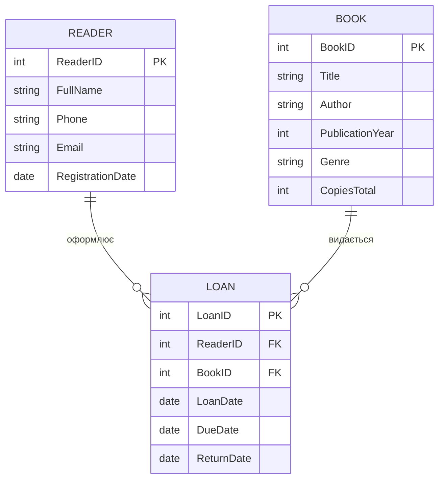

# Лабораторна робота №1. Збір вимог та розробка схеми ER

Обраний домен: Бібліотека (облік читачів, книг та видачі книг).

## Мета:

Здобути практичні навички збору й аналізу вимог до інформаційної системи: визначення даних, які потрібно зберігати, бізнес-правил і завдань користувачів. Навчитися на їх основі будувати концептуальну ER-діаграму на прикладі обраної предметної області.

## Завдання:

- зібрати та задокументувати вимоги до системи;
- ідентифікувати сутності та їхні атрибути;
- визначити зв'язки між сутностями та їхню кардинальність;
- розробити ER-діаграму;
- сформулювати обмеження системи.

## Виконання роботи:

### 1. Вимоги до системи:

_Призначення системи_.
Система призначена для обліку книжкового фонду невеликої бібліотеки, реєстрації читачів і фіксації видачі та повернення книг.

_Зацікавлені сторони_.
Бібліотекар (працює із системою щодня) і читач (отримує книги).

_Дані для зберігання_.

- Читачі: ПІБ, номер телефону, email, дата реєстрації.
- Книги: назва, автор, рік видання, жанр, кількість примірників.
- Видачі: який читач узяв яку книгу, дата видачі, очікувана дата повернення, фактична дата повернення.

_Завдання користувачів (бібліотекаря)_.

- зареєструвати нового читача;
- додати книгу до каталогу;
- видати книгу читачу;
- прийняти повернену книгу;
- переглянути, які книги зараз на руках у конкретного читача;
- знайти книгу за назвою чи автором.

_Бізнес-правила_.

- Читач може одночасно мати на руках не більше 5 книг.
- Стандартний строк користування книгою становить 14 днів.
- Книгу не можна видати, якщо всі її примірники вже на руках.
- Одну книгу протягом часу можуть брати різні читачі, а читач може брати різні книги.
- Кожна видача фіксує дату видачі, і лише після повернення заповнюється дата повернення.

### 2. Сутності та атрибути:

У системі три сутності: **Reader** (читач), **Book** (книга) та **Loan** (видача). Loan є асоціативною сутністю, яка реалізує зв'язок «багато до багатьох» між читачами та книгами.

**Сутність 1. Reader (Читач)**

| Атрибут           | Опис                            | Тип даних (концептуально) | Обмеження                  |
| ----------------- | ------------------------------- | ------------------------- | -------------------------- |
| **ReaderID** (PK) | Унікальний ідентифікатор читача | ціле число                | унікальний, обов'язковий   |
| FullName          | ПІБ читача                      | текст                     | обов'язковий               |
| Phone             | Номер телефону                  | текст                     | унікальний, обов'язковий   |
| Email             | Електронна пошта                | текст                     | унікальний, необов'язковий |
| RegistrationDate  | Дата реєстрації                 | дата                      | обов'язковий               |

**Сутність 2. Book (Книга)**

| Атрибут         | Опис                           | Тип даних (концептуально) | Обмеження                |
| --------------- | ------------------------------ | ------------------------- | ------------------------ |
| **BookID** (PK) | Унікальний ідентифікатор книги | ціле число                | унікальний, обов'язковий |
| Title           | Назва                          | текст                     | обов'язковий             |
| Author          | Автор                          | текст                     | обов'язковий             |
| PublicationYear | Рік видання                    | ціле число                | обов'язковий             |
| Genre           | Жанр                           | текст                     | необов'язковий           |
| CopiesTotal     | Кількість примірників          | ціле число                | обов'язковий, ≥ 1        |

**Сутність 3. Loan (Видача)**

| Атрибут         | Опис                                           | Тип даних (концептуально) | Обмеження                                          |
| --------------- | ---------------------------------------------- | ------------------------- | -------------------------------------------------- |
| **LoanID** (PK) | Унікальний ідентифікатор видачі                | ціле число                | унікальний, обов'язковий                           |
| ReaderID (FK)   | Який читач узяв книгу                          | ціле число                | обов'язковий, посилається на Reader                |
| BookID (FK)     | Яку книгу взято                                | ціле число                | обов'язковий, посилається на Book                  |
| LoanDate        | Дата видачі                                    | дата                      | обов'язковий                                       |
| DueDate         | Очікувана дата повернення (LoanDate + 14 днів) | дата                      | обов'язковий                                       |
| ReturnDate      | Фактична дата повернення                       | дата                      | необов'язковий (порожній, поки книгу не повернуто) |

**Пояснення вибору**

- Для Loan використано окремий ключ **LoanID**, а не складений (ReaderID + BookID). Так той самий читач може взяти ту саму книгу повторно в інший час, і це буде окремий запис.
- Атрибут **ReturnDate** порожній, доки книга на руках. За ним визначаємо, які книги видані зараз: ті, де ReturnDate порожній.
- Кількість вільних примірників не зберігаємо окремо, її можна обчислити: CopiesTotal мінус кількість активних видач цієї книги.

### 3. Зв'язки між сутностями:

У спроектованій БД будуть існувати наступні зв'язки:

1. **Читач – Видача (Reader – Loan)**
   - _Тип зв'язку_: one-to-many.
   - _Опис_: Один читач може брати книги безліч разів, але кожна видача оформлюється лише на одного конкретного читача. У таблиці Loan це фіксується через FK reader_id.

2. **Книга – Видача (Book – Loan)**
   - _Тип зв'язку_: one-to-many.
   - _Опис_: Одна книга може фігурувати в багатьох видачах (різні читачі в різний час), але кожна видача стосується лише однієї книги. У таблиці Loan це фіксується через FK book_id.

Таким чином, зв'язок many-to-many між читачами та книгами реалізовано через асоціативну сутність Loan, яка додатково зберігає дати видачі та повернення.

### 4. ER-діаграма:

Код у форматі Mermaid.

### 5. Обмеження до системи:

У спроектованій БД будуть діяти наступні обмеження:

1. Обмеження цілісності сутностей (первинні ключі)
   · Reader.ReaderID, Book.BookID, Loan.LoanID: унікальні та обов'язкові (PRIMARY KEY).

2. Обмеження посилальної цілісності (зовнішні ключі)
   · Loan.ReaderID має посилатися на існуючого читача (Reader.ReaderID).
   · Loan.BookID має посилатися на існуючу книгу (Book.BookID).
   · Не можна видалити читача чи книгу, якщо для них існують записи у Loan.

3. Обмеження унікальності
   · Reader.Phone: унікальний (два читачі не можуть мати однаковий номер).
   · Reader.Email: унікальний, якщо вказаний.

4. Обов'язкові поля (NOT NULL)
   · Reader: FullName, Phone, RegistrationDate.
   · Book: Title, Author, PublicationYear, CopiesTotal.
   · Loan: ReaderID, BookID, LoanDate, DueDate.
   · Необов'язкові: Reader.Email, Book.Genre, Loan.ReturnDate.

5. Обмеження значень (CHECK)
   · Book.CopiesTotal ≥ 1.
   · Book.PublicationYear не може бути більшим за поточний рік.
   · Loan.DueDate ≥ Loan.LoanDate.
   · Loan.ReturnDate, якщо заповнена, ≥ Loan.LoanDate.

6. Бізнес-обмеження
   · Читач може одночасно мати на руках не більше 5 книг (тобто не більше 5 записів Loan із порожнім ReturnDate).
   · Стандартний строк користування книгою: 14 днів (DueDate = LoanDate + 14 днів).
   · Книгу не можна видати, якщо кількість активних видач цієї книги дорівнює CopiesTotal.
   · Порожня ReturnDate означає, що книга досі на руках.

## Висновок:

У ході виконання лабораторної роботи №1 було здобуто практичні навички збору та аналізу вимог до інформаційної системи на прикладі предметної області «Бібліотека». Було визначено призначення системи, зацікавлені сторони, дані для зберігання, завдання користувачів та бізнес-правила.

На основі вимог виділено три сутності: Reader (читач), Book (книга) та Loan (видача), для кожної з яких визначено атрибути та первинні ключі. Зв'язок many-to-many між читачами та книгами реалізовано через асоціативну сутність Loan за допомогою двох зв'язків one-to-many. Побудовано ER-діаграму в нотації «воронячої лапки».

Також сформульовано обмеження системи: цілісності сутностей і посилальної цілісності, унікальності, обов'язковості полів, допустимих значень та бізнес-обмеження (ліміт у 5 книг на читача, строк користування 14 днів, перевірка наявності вільних примірників).

Отримана концептуальна модель є основою для наступних лабораторних робіт: створення таблиць у PostgreSQL, написання SQL-запитів, нормалізації та міграцій схеми.
