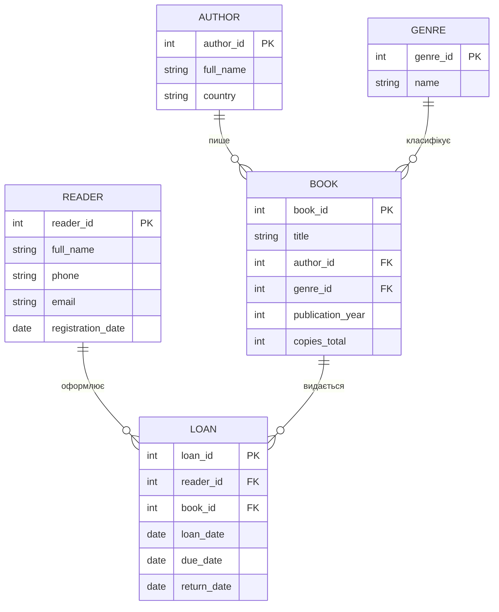

# Лабораторна робота №1. Збір вимог та розробка схеми ER

## Мета

Здобути практичні навички збору й аналізу вимог до інформаційної системи: визначення даних, які потрібно зберігати, бізнес-правил і завдань користувачів. Навчитися на їх основі будувати концептуальну ER-діаграму на прикладі обраної предметної області.

## Завдання

- зібрати та задокументувати вимоги до системи;
- ідентифікувати сутності та їхні атрибути;
- визначити зв'язки між сутностями та їхню кардинальність;
- розробити ER-діаграму;
- сформулювати обмеження системи.

## Обраний домен

Бібліотека (облік читачів, книг, авторів, жанрів та видачі книг).

---

## 5.1. Вимоги до системи

**Призначення системи.** Система призначена для обліку книжкового фонду невеликої бібліотеки, реєстрації читачів і фіксації видачі та повернення книг.

**Зацікавлені сторони.** Бібліотекар (працює із системою щодня) і читач (отримує книги).

**Дані для зберігання.**

- **Читачі:** ПІБ, номер телефону, email, дата реєстрації.
- **Автори:** ПІБ, країна.
- **Жанри:** назва жанру.
- **Книги:** назва, автор, жанр, рік видання, кількість примірників.
- **Видачі:** який читач узяв яку книгу, дата видачі, очікувана дата повернення, фактична дата повернення.
  **Завдання користувачів (бібліотекаря).**

- зареєструвати нового читача;
- додати автора та жанр до довідників;
- додати книгу до каталогу;
- видати книгу читачу;
- прийняти повернену книгу;
- переглянути, які книги зараз на руках у конкретного читача;
- знайти книгу за назвою, автором чи жанром.
  **Бізнес-правила.**

- Читач може одночасно мати на руках не більше 5 книг.
- Стандартний строк користування книгою становить 14 днів.
- Книгу не можна видати, якщо всі її примірники вже на руках.
- Кожна книга має одного автора та належить до одного жанру.
- Один автор може мати багато книг, до одного жанру може належати багато книг.
- Одну книгу протягом часу можуть брати різні читачі, а читач може брати різні книги.
- Кожна видача фіксує дату видачі, і лише після повернення заповнюється дата повернення.

---

## 5.2. Сутності та атрибути

У системі п'ять сутностей: **Reader** (читач), **Author** (автор), **Genre** (жанр), **Book** (книга) та **Loan** (видача). Loan є асоціативною сутністю, яка реалізує зв'язок «багато до багатьох» між читачами та книгами.

### Сутність 1. Reader (Читач)

| Атрибут            | Опис                            | Тип даних  | Обмеження                  |
| ------------------ | ------------------------------- | ---------- | -------------------------- |
| **reader_id** (PK) | Унікальний ідентифікатор читача | ціле число | унікальний, обов'язковий   |
| full_name          | ПІБ читача                      | текст      | обов'язковий               |
| phone              | Номер телефону                  | текст      | унікальний, обов'язковий   |
| email              | Електронна пошта                | текст      | унікальний, необов'язковий |
| registration_date  | Дата реєстрації                 | дата       | обов'язковий               |

### Сутність 2. Author (Автор)

| Атрибут            | Опис                            | Тип даних  | Обмеження                |
| ------------------ | ------------------------------- | ---------- | ------------------------ |
| **author_id** (PK) | Унікальний ідентифікатор автора | ціле число | унікальний, обов'язковий |
| full_name          | ПІБ автора                      | текст      | обов'язковий             |
| country            | Країна автора                   | текст      | необов'язковий           |

### Сутність 3. Genre (Жанр)

| Атрибут           | Опис                           | Тип даних  | Обмеження                |
| ----------------- | ------------------------------ | ---------- | ------------------------ |
| **genre_id** (PK) | Унікальний ідентифікатор жанру | ціле число | унікальний, обов'язковий |
| name              | Назва жанру                    | текст      | унікальний, обов'язковий |

### Сутність 4. Book (Книга)

| Атрибут          | Опис                           | Тип даних  | Обмеження                           |
| ---------------- | ------------------------------ | ---------- | ----------------------------------- |
| **book_id** (PK) | Унікальний ідентифікатор книги | ціле число | унікальний, обов'язковий            |
| title            | Назва                          | текст      | обов'язковий                        |
| author_id (FK)   | Автор книги                    | ціле число | обов'язковий, посилається на Author |
| genre_id (FK)    | Жанр книги                     | ціле число | обов'язковий, посилається на Genre  |
| publication_year | Рік видання                    | ціле число | обов'язковий                        |
| copies_total     | Кількість примірників          | ціле число | обов'язковий, ≥ 1                   |

### Сутність 5. Loan (Видача)

| Атрибут          | Опис                                            | Тип даних  | Обмеження                                          |
| ---------------- | ----------------------------------------------- | ---------- | -------------------------------------------------- |
| **loan_id** (PK) | Унікальний ідентифікатор видачі                 | ціле число | унікальний, обов'язковий                           |
| reader_id (FK)   | Який читач узяв книгу                           | ціле число | обов'язковий, посилається на Reader                |
| book_id (FK)     | Яку книгу взято                                 | ціле число | обов'язковий, посилається на Book                  |
| loan_date        | Дата видачі                                     | дата       | обов'язковий                                       |
| due_date         | Очікувана дата повернення (loan_date + 14 днів) | дата       | обов'язковий                                       |
| return_date      | Фактична дата повернення                        | дата       | необов'язковий (порожній, поки книгу не повернуто) |

### Пояснення вибору

- Автор і жанр винесені в окремі сутності, щоб не повторювати їх текстом у кожній книзі: ім'я автора чи назва жанру зберігаються один раз.
- Для Loan використано окремий ключ **loan_id**, а не складений (reader_id + book_id). Так той самий читач може взяти ту саму книгу повторно в інший час, і це буде окремий запис.
- Атрибут **return_date** порожній, доки книга на руках. За ним визначаємо, які книги видані зараз.
- Кількість вільних примірників не зберігаємо окремо, її можна обчислити: copies_total мінус кількість активних видач цієї книги.

---

## 5.3. Зв'язки між сутностями

У спроектованій БД будуть існувати наступні зв'язки:

1. Автор – Книга (Author – Book)
   - Тип зв'язку: one-to-many.
   - Опис: Один автор може мати багато книг у каталозі, але кожна книга закріплена лише за одним автором. У таблиці Book це фіксується через FK author_id.
2. Жанр – Книга (Genre – Book)
   - Тип зв'язку: one-to-many.
   - Опис: До одного жанру може належати багато книг, але кожна книга має лише один жанр. У таблиці Book це фіксується через FK genre_id.
3. Читач – Видача (Reader – Loan)
   - Тип зв'язку: one-to-many.
   - Опис: Один читач може брати книги безліч разів, але кожна видача оформлюється лише на одного конкретного читача. У таблиці Loan це фіксується через FK reader_id.
4. Книга – Видача (Book – Loan)
   - Тип зв'язку: one-to-many.
   - Опис: Одна книга може фігурувати в багатьох видачах (різні читачі в різний час), але кожна видача стосується лише однієї книги. У таблиці Loan це фіксується через FK book_id.
     Таким чином, зв'язок many-to-many між читачами та книгами реалізовано через асоціативну сутність Loan, яка додатково зберігає дати видачі та повернення.

---

## 5.4. ER-діаграма

---

## 5.5. Обмеження до системи

У спроектованій БД будуть діяти наступні обмеження:

**1. Первинні ключі (PRIMARY KEY)**

- Reader.reader_id, Author.author_id, Genre.genre_id, Book.book_id, Loan.loan_id: унікальні та обов'язкові.

**2. Зовнішні ключі (FOREIGN KEY)**

- Book.author_id має посилатися на існуючого автора (Author.author_id).
- Book.genre_id має посилатися на існуючий жанр (Genre.genre_id).
- Loan.reader_id має посилатися на існуючого читача (Reader.reader_id).
- Loan.book_id має посилатися на існуючу книгу (Book.book_id).
- Не можна видалити автора, жанр, читача чи книгу, якщо на них посилаються записи в дочірніх таблицях (Book або Loan).

**3. Унікальність (UNIQUE)**

- Reader.phone: унікальний.
- Reader.email: унікальний, якщо вказаний.
- Genre.name: унікальний (жанр не дублюється).

**4. Обов'язкові поля (NOT NULL)**

- Reader: full_name, phone, registration_date.
- Author: full_name.
- Genre: name.
- Book: title, author_id, genre_id, publication_year, copies_total.
- Loan: reader_id, book_id, loan_date, due_date.
- Необов'язкові: Reader.email, Author.country, Loan.return_date.

**5. Перевірка значень (CHECK)**

- Book.copies_total ≥ 1.
- Book.publication_year не може бути більшим за поточний рік.
- Loan.due_date ≥ Loan.loan_date.
- Loan.return_date, якщо заповнена, ≥ Loan.loan_date.

**6. Бізнес-обмеження**

- Читач може одночасно мати на руках не більше 5 книг (не більше 5 записів Loan із порожнім return_date).
- Стандартний строк користування книгою: 14 днів (due_date = loan_date + 14 днів).
- Книгу не можна видати, якщо кількість активних видач цієї книги дорівнює copies_total.
- Порожня return*date означає, що книга досі на руках.
  *Примітка.\_ Правила з пункту 6 потребують підрахунку інших рядків, тому їх буде реалізовано в наступних лабораторних роботах (через запити, тригери або логіку застосунку).

**Припущення**

- Кожна книга має лише одного автора (книги зі співавторами в межах роботи не розглядаються).
- Кожна книга належить лише до одного жанру.
- Усі примірники однієї книги вважаються однаковими, окремо вони не обліковуються (достатньо кількості copies_total).
- Книги можуть видаватися лише зареєстрованим читачам.

---

## 6. Висновок

У ході виконання лабораторної роботи №1 було здобуто практичні навички збору та аналізу вимог до інформаційної системи на прикладі предметної області «Бібліотека». Було визначено призначення системи, зацікавлені сторони, дані для зберігання, завдання користувачів та бізнес-правила.

На основі вимог виділено п'ять сутностей: Reader (читач), Author (автор), Genre (жанр), Book (книга) та Loan (видача), для кожної з яких визначено атрибути та первинні ключі. Автор і жанр винесено в окремі сутності, щоб уникнути дублювання даних. Зв'язок many-to-many між читачами та книгами реалізовано через асоціативну сутність Loan за допомогою двох зв'язків one-to-many. Усього в моделі чотири зв'язки, всі типу one-to-many. Побудовано ER-діаграму в нотації «воронячої лапки».

Також сформульовано обмеження системи: цілісності сутностей і посилальної цілісності, унікальності, обов'язковості полів, допустимих значень та бізнес-обмеження (ліміт у 5 книг на читача, строк користування 14 днів, перевірка наявності вільних примірників), а також зроблені припущення.

Отримана концептуальна модель є основою для наступних лабораторних робіт: створення таблиць у PostgreSQL, написання SQL-запитів, нормалізації та міграцій схеми.
