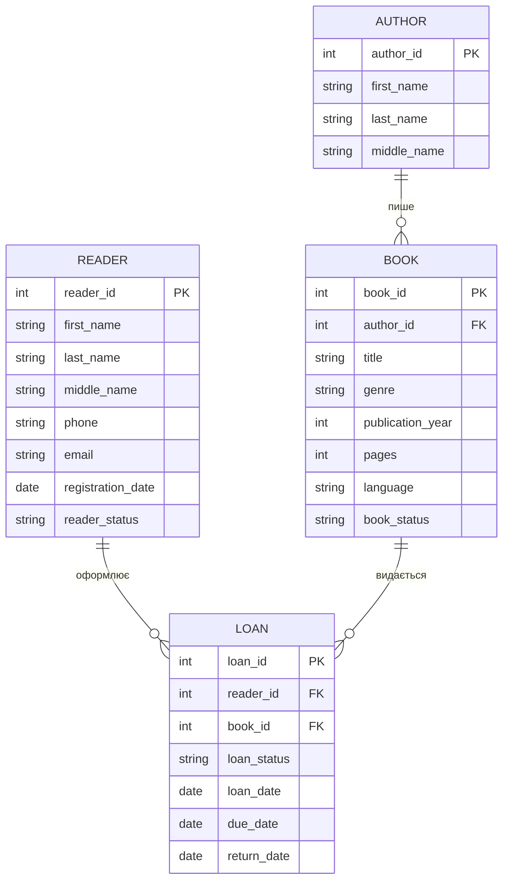

# Лабораторна робота №1. Збір вимог та розробка схеми ER

## Мета

Здобути практичні навички збору й аналізу вимог до інформаційної системи: визначення даних, які потрібно зберігати, бізнес-правил і завдань користувачів. Навчитися на їх основі будувати концептуальну ER-діаграму на прикладі обраної предметної області.

## Завдання

- зібрати та задокументувати вимоги до системи;
- ідентифікувати сутності та їхні атрибути;
- визначити зв'язки між сутностями та їхню кардинальність;
- розробити ER-діаграму;
- сформулювати обмеження системи.

## Обраний домен

Бібліотека (облік читачів, книг, авторів та видачі книг).

---

## 5.1. Вимоги до системи

**Призначення системи.** Система призначена для обліку книжкового фонду невеликої бібліотеки, реєстрації читачів і фіксації видачі та повернення книг.

**Зацікавлені сторони.** Бібліотекар (працює із системою щодня) і читач (отримує книги).

**Дані для зберігання.**

- **Читачі:** прізвище, ім'я, по батькові, номер телефону, email, дата реєстрації, статус (активний або неактивний).
- **Автори:** прізвище, ім'я, по батькові (за наявності).
- **Книги:** назва, автор, жанр, рік видання, кількість сторінок, мова, статус (доступна або недоступна).
- **Видачі:** який читач узяв яку книгу, дата видачі, очікувана дата повернення, фактична дата повернення, статус видачі.

**Завдання користувачів (бібліотекаря).**

- зареєструвати нового читача;
- додати автора до довідника;
- додати книгу до каталогу;
- видати книгу читачу;
- прийняти повернену книгу;
- переглянути, які книги зараз на руках у конкретного читача;
- знайти книгу за назвою, автором чи жанром;
- змінити статус читача чи книги.

**Бізнес-правила.**

- Читач може одночасно мати на руках не більше 5 книг.
- Стандартний строк користування книгою становить 14 днів.
- Книгу не можна видати, якщо вона має статус «недоступна» (наприклад, уже на руках).
- Книгу можна видати лише активному читачу.
- Кожна книга має одного автора, а автор може мати багато книг.
- Одну книгу протягом часу можуть брати різні читачі, а читач може брати різні книги.
- Кожна видача фіксує дату видачі, і лише після повернення заповнюється дата повернення.

---

## 5.2. Сутності та атрибути

У системі чотири сутності: **Reader** (читач), **Author** (автор), **Book** (книга) та **Loan** (видача). Loan є асоціативною сутністю, яка реалізує зв'язок «багато до багатьох» між читачами та книгами.

### Сутність 1. Reader (Читач)

| Атрибут            | Опис                            | Тип даних                      | Обмеження                                   |
| ------------------ | ------------------------------- | ------------------------------ | ------------------------------------------- |
| **reader_id** (PK) | Унікальний ідентифікатор читача | ціле число                     | унікальний, обов'язковий                    |
| first_name         | Ім'я                            | текст                          | обов'язковий                                |
| last_name          | Прізвище                        | текст                          | обов'язковий                                |
| middle_name        | По батькові                     | текст                          | обов'язковий                                |
| phone              | Номер телефону                  | текст                          | унікальний, обов'язковий                    |
| email              | Електронна пошта                | текст                          | унікальний, обов'язковий                    |
| registration_date  | Дата реєстрації                 | дата                           | обов'язковий, за замовчуванням поточна дата |
| reader_status      | Статус читача                   | перелік (`active`, `inactive`) | обов'язковий, за замовчуванням `active`     |

### Сутність 2. Author (Автор)

| Атрибут            | Опис                            | Тип даних  | Обмеження                |
| ------------------ | ------------------------------- | ---------- | ------------------------ |
| **author_id** (PK) | Унікальний ідентифікатор автора | ціле число | унікальний, обов'язковий |
| first_name         | Ім'я                            | текст      | обов'язковий             |
| last_name          | Прізвище                        | текст      | обов'язковий             |
| middle_name        | По батькові                     | текст      | необов'язковий           |

### Сутність 3. Book (Книга)

| Атрибут          | Опис                           | Тип даних                            | Обмеження                                  |
| ---------------- | ------------------------------ | ------------------------------------ | ------------------------------------------ |
| **book_id** (PK) | Унікальний ідентифікатор книги | ціле число                           | унікальний, обов'язковий                   |
| author_id (FK)   | Автор книги                    | ціле число                           | обов'язковий, посилається на Author        |
| title            | Назва                          | текст                                | обов'язковий                               |
| genre            | Жанр                           | текст                                | необов'язковий                             |
| publication_year | Рік видання                    | ціле число                           | необов'язковий                             |
| pages            | Кількість сторінок             | ціле число                           | обов'язковий, > 0                          |
| language         | Мова видання                   | текст                                | необов'язковий                             |
| book_status      | Статус книги                   | перелік (`available`, `unavailable`) | обов'язковий, за замовчуванням `available` |

### Сутність 4. Loan (Видача)

| Атрибут          | Опис                                            | Тип даних                               | Обмеження                                                       |
| ---------------- | ----------------------------------------------- | --------------------------------------- | --------------------------------------------------------------- |
| **loan_id** (PK) | Унікальний ідентифікатор видачі                 | ціле число                              | унікальний, обов'язковий                                        |
| reader_id (FK)   | Який читач узяв книгу                           | ціле число                              | обов'язковий, посилається на Reader                             |
| book_id (FK)     | Яку книгу взято                                 | ціле число                              | обов'язковий, посилається на Book                               |
| loan_status      | Статус видачі                                   | перелік (`available`, `loan`, `return`) | обов'язковий, за замовчуванням `available`                      |
| loan_date        | Дата видачі                                     | дата                                    | обов'язковий, за замовчуванням поточна дата                     |
| due_date         | Очікувана дата повернення (loan_date + 14 днів) | дата                                    | обов'язковий, ≥ loan_date                                       |
| return_date      | Фактична дата повернення                        | дата                                    | необов'язковий (порожній, поки книгу не повернуто), ≥ loan_date |

### Пояснення вибору

- Автор винесений в окрему сутність, щоб його ПІБ зберігалося один раз, а не повторювалося в кожній книзі.
- Для Loan використано окремий ключ **loan_id**, а не складений (reader_id + book_id). Так той самий читач може взяти ту саму книгу повторно в інший час, і це буде окремий запис.
- Кожен запис у Book відповідає одній фізичній книзі, тому наявність книги визначається атрибутом **book_status**, а не кількістю примірників.
- Атрибут **return_date** порожній, доки книга на руках.
- Статуси читача, книги та видачі задаються переліком допустимих значень, що виключає довільний текст.

---

## 5.3. Зв'язки між сутностями

У спроектованій БД будуть існувати наступні зв'язки:

1. Автор – Книга (Author – Book)
   - Тип зв'язку: one-to-many.
   - Опис: Один автор може мати багато книг у каталозі, але кожна книга закріплена лише за одним автором. У таблиці Book це фіксується через FK author_id.

2. Читач – Видача (Reader – Loan)
   - Тип зв'язку: one-to-many.
   - Опис: Один читач може брати книги безліч разів, але кожна видача оформлюється лише на одного конкретного читача. У таблиці Loan це фіксується через FK reader_id.

3. Книга – Видача (Book – Loan)
   - Тип зв'язку: one-to-many.
   - Опис: Одна книга може фігурувати в багатьох видачах (різні читачі в різний час), але кожна видача стосується лише однієї книги. У таблиці Loan це фіксується через FK book_id.

Таким чином, зв'язок many-to-many між читачами та книгами реалізовано через асоціативну сутність Loan, яка додатково зберігає дати видачі та повернення і статус видачі.

---

## 5.4. ER-діаграма

---

## 5.5. Обмеження до системи

У спроектованій БД будуть діяти наступні обмеження:

**1. Первинні ключі (PRIMARY KEY)**

- Reader.reader_id, Author.author_id, Book.book_id, Loan.loan_id: унікальні та обов'язкові.

**2. Зовнішні ключі (FOREIGN KEY)**

- Book.author_id має посилатися на існуючого автора (Author.author_id).
- Loan.reader_id має посилатися на існуючого читача (Reader.reader_id).
- Loan.book_id має посилатися на існуючу книгу (Book.book_id).
- Не можна видалити автора, читача чи книгу, якщо на них посилаються записи в дочірніх таблицях (Book або Loan).

**3. Унікальність (UNIQUE)**

- Reader.phone та Reader.email: унікальні.

**4. Обов'язкові поля (NOT NULL)**

- Reader: first_name, last_name, middle_name, phone, email, registration_date, reader_status.
- Author: first_name, last_name.
- Book: author_id, title, pages, book_status.
- Loan: reader_id, book_id, loan_status, loan_date, due_date.
- Необов'язкові: Author.middle_name, Book.genre, Book.publication_year, Book.language, Loan.return_date.

**5. Перевірка значень (CHECK)**

- Book.pages > 0.
- Loan.due_date ≥ Loan.loan_date.
- Loan.return_date, якщо заповнена, ≥ Loan.loan_date.

**6. Допустимі значення (ENUM) та значення за замовчуванням (DEFAULT)**

- Reader.reader_status: `active`, `inactive` (за замовчуванням `active`).
- Book.book_status: `available`, `unavailable` (за замовчуванням `available`).
- Loan.loan_status: `available`, `loan`, `return` (за замовчуванням `available`).
- Reader.registration_date та Loan.loan_date за замовчуванням дорівнюють поточній даті.

**7. Бізнес-обмеження**

- Читач може одночасно мати на руках не більше 5 книг (не більше 5 записів Loan із порожнім return_date).
- Стандартний строк користування книгою: 14 днів (due_date = loan_date + 14 днів).
- Книгу зі статусом `unavailable` видати не можна.
- Книгу можна видати лише читачу зі статусом `active`.
- Порожня return_date означає, що книга досі на руках.

_Примітка._ Правила з пункту 7 потребують перевірки значень в інших таблицях або підрахунку рядків, тому їх буде реалізовано в наступних лабораторних роботах (через запити, тригери або логіку застосунку).

**Припущення**

- Кожна книга має лише одного автора (книги зі співавторами в межах роботи не розглядаються).
- Кожен запис у таблиці книг відповідає одній фізичній книзі, кількість примірників окремо не обліковується.
- Жанр і мова зберігаються як текст і не винесені в окремі сутності.
- Книги можуть видаватися лише зареєстрованим читачам.

---

## 6. Висновок

У ході виконання лабораторної роботи №1 було здобуто практичні навички збору та аналізу вимог до інформаційної системи на прикладі предметної області «Бібліотека». Було визначено призначення системи, зацікавлені сторони, дані для зберігання, завдання користувачів та бізнес-правила.

На основі вимог виділено чотири сутності: Reader (читач), Author (автор), Book (книга) та Loan (видача), для кожної з яких визначено атрибути та первинні ключі. Автор винесений в окрему сутність, щоб уникнути дублювання даних, а статуси читача, книги та видачі задано переліками допустимих значень. Зв'язок many-to-many між читачами та книгами реалізовано через асоціативну сутність Loan за допомогою двох зв'язків one-to-many. Усього в моделі три зв'язки, всі типу one-to-many. Побудовано ER-діаграму в нотації «воронячої лапки».

Також сформульовано обмеження системи: цілісності сутностей і посилальної цілісності, унікальності, обов'язковості полів, допустимих значень та бізнес-обмеження (ліміт у 5 книг на читача, строк користування 14 днів, перевірка статусів читача й книги), а також зроблені припущення.

Отримана концептуальна модель є основою для наступних лабораторних робіт: створення таблиць у PostgreSQL, написання SQL-запитів, нормалізації та міграцій схеми.
